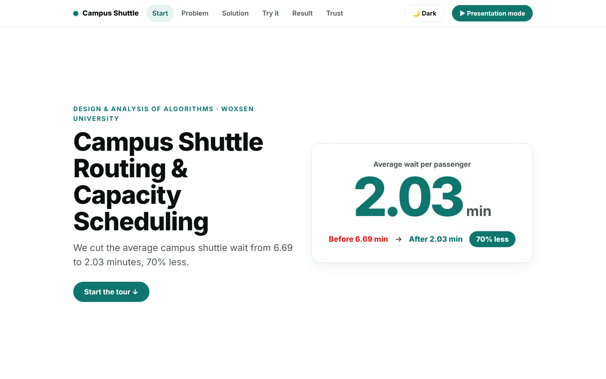
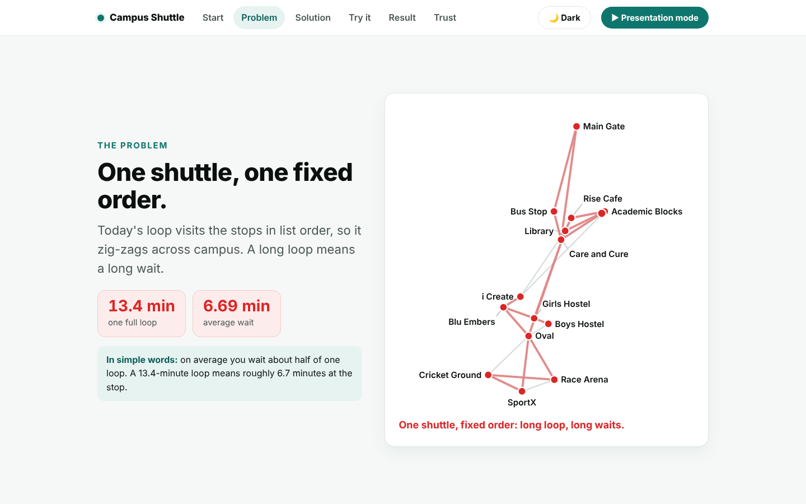
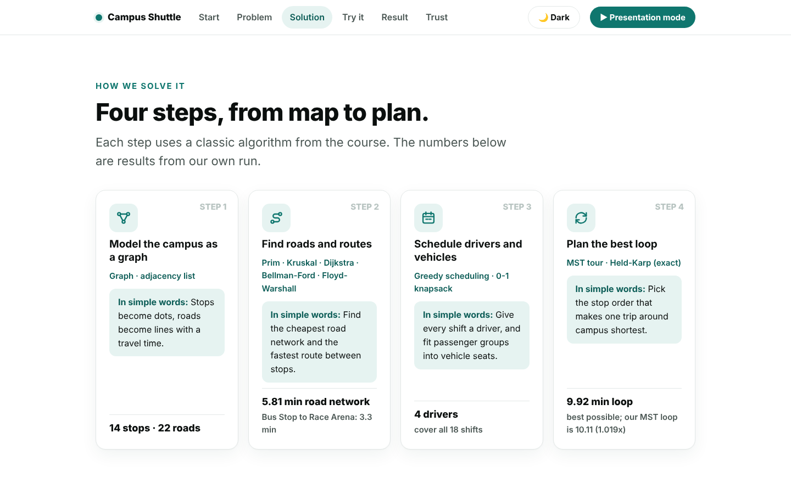
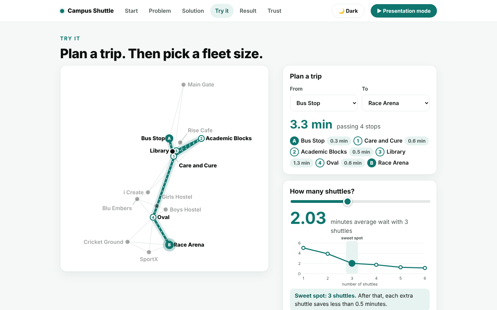
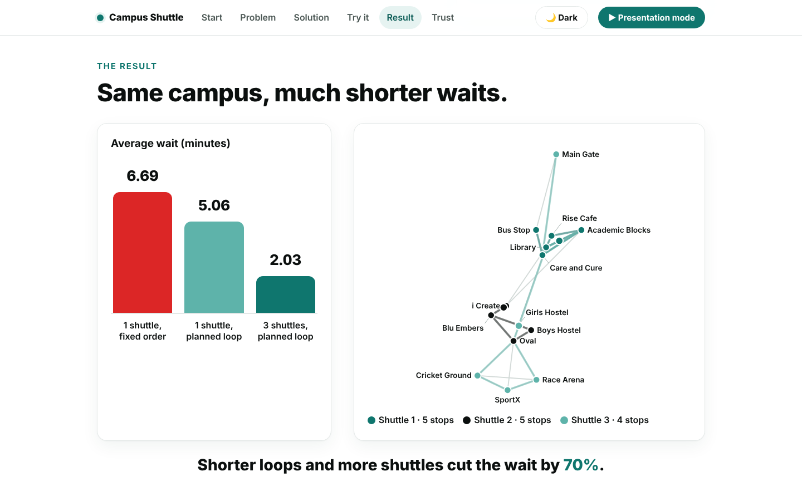
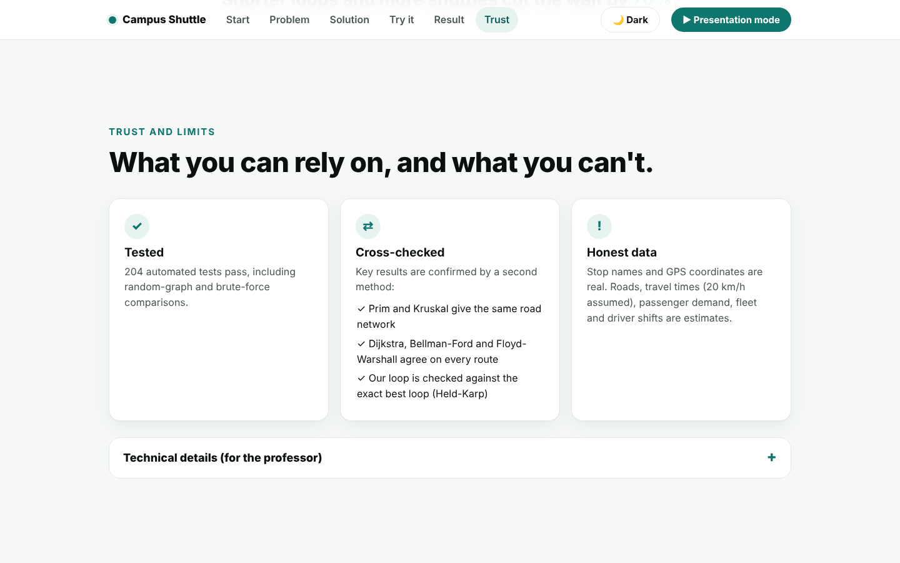

# Campus Shuttle Routing & Capacity Scheduling

**Design and Analysis of Algorithms (DAA) group project | Woxsen University, B.Tech AI & ML**

Faculty: Dr. Syed Javeed Pasha

[**Live demo**](https://ritheekyadav01-afk.github.io/DAA_PBL/) | [Project report (PDF)](docs/DAA_Project_Report.pdf) | [Final review deck (PDF)](final_review/DAA_Campus_Shuttle_Deck.pdf) | [Walkthrough notebook](notebooks/walkthrough.ipynb)

  

---

## Contents

1. [Overview](#1-overview)
2. [Live demo and the website](#2-live-demo-and-the-website)
3. [Quick start](#3-quick-start)
4. [Results](#4-results)
5. [Algorithms used](#5-algorithms-used)
6. [How the model works](#6-how-the-model-works)
7. [Data: what is real and what is estimated](#7-data-what-is-real-and-what-is-estimated)
8. [Repository layout](#8-repository-layout)
9. [Verification](#9-verification)
10. [Documents](#10-documents)
11. [Limitations and future work](#11-limitations-and-future-work)
12. [Team](#12-team)
13. [References](#13-references)

---

## 1. Overview

A campus shuttle is only useful if passengers do not wait long. We model **14 Woxsen campus stops** as a weighted graph and apply the classical algorithm families from the course to design a better shuttle service: which roads matter, which routes are fastest, how many drivers are needed, how to load each vehicle, what loop to drive, and how many shuttles to run.

| Question | Algorithm(s) | Result on our data |
|---|---|---|
| Cheapest set of roads connecting all stops | Prim, Kruskal | 5.81 min total (both agree) |
| Fastest route between two stops | Dijkstra, Bellman-Ford | Bus Stop to Race Arena: 3.3 min |
| Fastest route between every pair | Floyd-Warshall | Longest shortest trip: 4.3 min (Main Gate to Cricket Ground) |
| Fewest drivers for the shifts | Greedy earliest-finish-time | 1 driver covers 8 of 18 shifts; 4 drivers cover all |
| Which passenger groups go on which vehicle | 0-1 knapsack (dynamic programming) | BUS-1 30/30 seats, BUS-2 19/20, VAN-1 9/12 |
| Best closed tour of all stops | Held-Karp (exact), nearest neighbour, MST 2-approximation | file order 13.37, nearest neighbour 10.11, MST 10.11, optimal 9.92 min |
| Passenger waiting time | Wait model (loop time / 2, demand weighted) | **6.69 min to 2.03 min (70% lower)** |

**Headline result:** with one shuttle visiting stops in file order, the average wait is 6.69 minutes. Three shuttles running contiguous slices of the MST-based tour bring it down to 2.03 minutes. The MST tour is within 1.019x of the exact optimum (theory only guarantees 2x).

## 2. Live demo and the website

### Open the live demo: https://ritheekyadav01-afk.github.io/DAA_PBL/

No install, no login and no setup: click the link and the website opens in any browser (laptop or phone). It is a single self-contained page that runs entirely in your browser, with no server and no internet needed after it loads. It is written so that someone who has never seen the project understands it in about 30 seconds.

**What to do on the live demo (2 minutes):**

1. Read the top screen: the whole project in one sentence, with the number that matters (average wait cut from 6.69 to 2.03 minutes).
2. Press **Presentation mode** (top right) to let it scroll through all six screens by itself, or use the arrow keys or the menu at the top to move yourself. `Esc` stops it.
3. On the **Try it** screen, pick any "From" and "To" stop to see the fastest route drawn on the map, then drag the **How many shuttles?** slider and watch the average wait change.
4. Use the **Dark / Light** button for your preferred theme.
5. Open **Technical details** on the last screen to see every algorithm, its complexity and its result.

**Screens**

### 1. Hero: the claim in one number


### 2. The problem: one shuttle, one fixed order
One shuttle visiting stops in file order zig-zags across campus: a 13.4 min loop and a 6.69 min average wait.



### 3. How we solve it: four steps
Graph, routes, scheduling and best loop, each with a plain-English line and its result.



### 4. Try it: plan a trip and pick a fleet size
Dijkstra draws the fastest route between any two stops; the slider changes the number of shuttles from 1 to 6 and marks the sweet spot (3).



### 5. The result: before vs after
Bars for 6.69, 5.06 and 2.03 minutes, and three shuttles running their own slices of the loop.



### 6. Trust and limits
Tests, cross-checks and an honest note on which data is estimated.



Everything on the page comes from our own Python code: `src/dashboard.py` runs the real algorithms (with live cross-checks), exports the results as JSON and injects them into `src/dashboard_template.html`. Nothing is typed in by hand.

**Run it locally instead:** `python main.py` regenerates `report/dashboard.html`; double-click it to open it. The live demo is the same file, published from the `docs/` folder with GitHub Pages.

**How it was built.** We designed and built this front end in **VS Code using Claude Code** (Anthropic's AI coding assistant, run in the VS Code terminal): we described the story and look we wanted, Claude Code wrote and edited `src/dashboard.py` and `src/dashboard_template.html`, and we reviewed, ran and tested every change ourselves. The algorithms and all the numbers come from our own Python code.

## 3. Quick start

You need Python 3.10 or newer and git.

**macOS / Linux**

```bash
git clone https://github.com/ritheekyadav01-afk/DAA_PBL.git
cd DAA_PBL
python3 -m venv .venv
source .venv/bin/activate
pip install -r requirements.txt
python main.py        # runs every algorithm, prints results, writes report/
pytest -q             # runs the automated tests
```

**Windows (Command Prompt)**

```bat
git clone https://github.com/ritheekyadav01-afk/DAA_PBL.git
cd DAA_PBL
python -m venv .venv
.venv\Scripts\activate
pip install -r requirements.txt
python main.py
pytest -q
```

Run the commands from inside the `DAA_PBL` folder. If `python` is not recognised on Windows, try `py` instead.

**Open the dashboard.** `python main.py` regenerates `report/dashboard.html`. Double-click it to open it in your browser. You can also skip running anything and use the live demo link above.

**Refresh the live demo** after changing the dashboard: `python main.py`, then `cp report/dashboard.html docs/index.html` (Windows: `copy report\dashboard.html docs\index.html`), commit and push. GitHub Pages serves the `/docs` folder.

## 4. Results

| Configuration | Average wait (min) |
|---|---|
| One shuttle, file order (baseline) | 6.69 |
| One shuttle, MST tour | 5.05 |
| Three shuttles, MST tour slices | **2.03** |

Fleet sensitivity (average wait): 1 shuttle 5.05, 2: 3.91, **3: 2.03**, 4: 1.75, 5: 1.26, 6: 1.12. Three shuttles is the knee of the curve: adding more helps, but with sharply diminishing returns.

Charts: `report/fleet_sensitivity.png` and `report/runtime_vs_complexity.png`.

Rounding note: the exact averages are 6.685 and 5.055 minutes. The dashboard rounds halves up (6.69, 5.06), while `main.py` prints with Python's `round` (6.68, 5.05).

## 5. Algorithms used

| Algorithm | Time | Space | Used for |
|---|---|---|---|
| Prim (binary heap) | O(E log V) | O(V+E) | Minimum spanning tree |
| Kruskal (union-find) | O(E log E) | O(V+E) | MST (cross-check) |
| Dijkstra | O((V+E) log V) | O(V) | Shortest routes |
| Bellman-Ford | O(VE) | O(V) | Cross-check, negative cycles |
| Floyd-Warshall | O(V^3) | O(V^2) | All-pairs distance matrix |
| Greedy interval scheduling | O(S log S) | O(S) | Shifts and drivers |
| 0-1 knapsack | O(nW) | O(nW) | Vehicle loading |
| Held-Karp | O(n^2 2^n) | O(n 2^n) | Exact tour (n = 14) |
| Nearest neighbour | O(n^2) | O(n) | Heuristic tour |
| MST preorder tour | O(V log V) | O(V) | 2-approximation tour |

## 6. How the model works

**Graph model.** Stops are vertices. Roads are undirected edges weighted by haversine (straight-line) distance divided by 20 km/h, in minutes.

**Wait model.** For a loop of T minutes and uniform passenger arrivals, the average wait at a stop is T/2, weighted by the number of passengers starting at each stop. The baseline is one shuttle visiting stops in file order. The improved plan uses three shuttles, each running a contiguous slice of the MST-based tour, which shortens every loop.

**Pipeline** (`main.py`): load data, build the graph, run MST, shortest paths, all-pairs, scheduling, knapsack and tour algorithms, compute the wait model and fleet sensitivity, run the runtime benchmarks, then write charts and the dashboard to `report/`.

## 7. Data: what is real and what is estimated

- `data/stops.csv`: **real** stop names and GPS coordinates.
- `data/edges.csv`, `data/demand.csv`, `data/fleet.csv`, `data/shifts.csv`: **estimates**. Which stops connect, the 20 km/h speed, passenger demand, fleet and shifts were not surveyed. Each file starts with a `# ESTIMATE` line (the loader skips `#` lines).

The algorithms are correct and run unchanged on measured data. Absolute minute values are only as good as these assumptions; the relative gains are the finding.

## 8. Repository layout

```
main.py                   entry point: runs the whole pipeline
requirements.txt          matplotlib, numpy, pytest
data/                     stops.csv (real); edges, demand, fleet, shifts (estimates)
src/
  graph.py                adjacency-list graph, min-heap, CSV loader
  mst.py                  Prim and Kruskal (union-find)
  sssp.py                 Dijkstra and Bellman-Ford (negative-cycle detection)
  apsp.py                 Floyd-Warshall with path reconstruction
  greedy.py               earliest-finish interval scheduling, driver assignment
  dp.py                   0-1 knapsack with item reconstruction
  tsp.py                  tour cost, nearest neighbour, MST preorder, Held-Karp
  wait_model.py           average wait, shuttle slicing
  sensitivity.py          wait vs fleet size
  experiments.py          random graphs, runtime benchmarks
  dashboard.py            builds the dashboard (exports real results as JSON)
  dashboard_template.html self-contained HTML/CSS/JS front end (no CDN, offline)
tests/test_algorithms.py  automated tests (cross-checks, brute force, dashboard)
report/                   generated dashboard.html and charts
docs/                     project report (docx, pdf) and index.html for the live demo
final_review/             final review deck (pptx, pdf)
notebooks/                walkthrough.ipynb
individual/               per-member LeetCode, HackerRank and MOOC submissions
```

## 9. Verification

Over 200 automated tests, mostly independent cross-checks: Prim vs Kruskal, Dijkstra vs Bellman-Ford vs Floyd-Warshall, Held-Karp vs brute-force permutations, knapsack vs brute-force subsets, and Held-Karp never losing to the heuristics, over many random seeds. Two further tests check that the dashboard is generated, contains the key numbers (5.81, 6.69, 2.03), has six sections and loads no external resources. A runtime benchmark (50 to 1600 nodes) confirms the expected growth.

Run them with `pytest -q`.

## 10. Documents

- [`docs/DAA_Project_Report.pdf`](docs/DAA_Project_Report.pdf) (and `.docx`): problem, literature survey, SRS, design, algorithms, results, testing, limitations.
- [`final_review/DAA_Campus_Shuttle_Deck.pdf`](final_review/DAA_Campus_Shuttle_Deck.pdf) (and `.pptx`): final review deck.
- [`notebooks/walkthrough.ipynb`](notebooks/walkthrough.ipynb): runs the pipeline, shows the charts and runs the tests.
- [`individual/`](individual/): each member's LeetCode, HackerRank and MOOC deliverables.

## 11. Limitations and future work

Straight-line distances at constant speed, no dwell time or traffic, an estimated demand and road set, static demand, contiguous-slice shuttles rather than a full vehicle-routing optimisation, and a greedy driver assignment that is a heuristic.

Future work: survey real roads and boardings, add dwell time and time-of-day demand, and try a proper vehicle-routing heuristic.

## 12. Team

| Name | Student ID |
|---|---|
| D. Ritheek (team lead) | 25WU0102057 |
| M. Srilakshmi | 25WU0102140 |
| B. Deekshan | 25WU0102037 |
| P. Priyakaran | 25WU0101090 |
| G. Madhan | 25WU0102344 |

Faculty: Dr. Syed Javeed Pasha. Submission date: 13-10-2026.

## 13. References

Cormen et al., *Introduction to Algorithms*; Kruskal (1956); Prim (1957); Dijkstra (1959); Bellman (1958); Floyd (1962); Held and Karp (1962); Rosenkrantz, Stearns and Lewis (1977). The full list is in the report.
